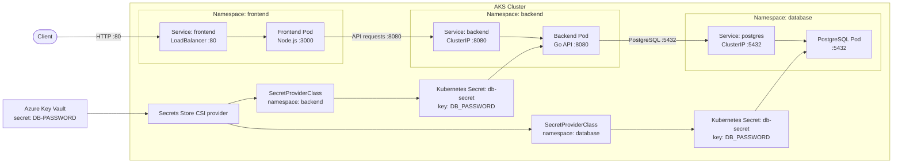

# Three-Tier Goal Tracker

A small goal-tracking application with a Node.js frontend, Go API, and PostgreSQL database, deployed to AKS using the Kubernetes manifests in this folder.

## Architecture



## Deploy to AKS After Infrastructure Provisioning

This workflow assumes Terraform has already provisioned AKS, ACR, and Key Vault, and the database password has already been pushed to Key Vault as `DB-PASSWORD` in `kvlearningvijaydev`.

### 1. Check Prerequisites

You need Azure CLI, `kubectl`, and Podman installed. The signed-in Azure identity must be able to access the cluster, Key Vault, and ACR.

Before deploying, confirm:

- AKS has the Azure Key Vault Secrets Store CSI provider enabled.
- The user-assigned identity in both SecretProviderClasses is attached to the AKS node VM scale set and can read Key Vault secrets.
- The AKS kubelet identity can pull images from `learningvijayacr`.
- The Key Vault contains the secret `DB-PASSWORD`.

To check the secret name without printing its value:

```sh
az keyvault secret show \
  --vault-name keyvaultobservabilitydev \
  --name DB-PASSWORD \
  --query name \
  --output tsv
```

### 2. Connect to AKS

```sh
az login
az account set --subscription <subscription-id>
az aks get-credentials \
  --resource-group <aks-resource-group> \
  --name <aks-cluster-name>
kubectl config current-context
kubectl get nodes
```

### 3. Build and Push the Container Images

Each Docker tier has a `push.sh` script. From the `3-Tier-Application` folder, run:

```sh
(cd Docker/frontend && ./push.sh)
(cd Docker/backend && ./push.sh)
(cd Docker/database && ./push.sh)
```

The scripts push these images:

- `learningvijayacr.azurecr.io/goal-tracker-frontend:latest`
- `learningvijayacr.azurecr.io/goal-tracker-backend:latest`
- `learningvijayacr.azurecr.io/postgres:15`

### 4. Deploy the Kubernetes Resources

From the `3-Tier-Application` folder:

```sh
cd k8s
./deploy.sh
```

The script applies the namespaces first, then database, backend, and frontend resources. It also prints pod and Service status for each namespace. The frontend Service is a `LoadBalancer` on port 80; backend and PostgreSQL are internal `ClusterIP` Services on ports 8080 and 5432.

### 5. Verify and Open the Application

Check rollouts and Services:

```sh
kubectl rollout status deployment/postgres -n database
kubectl rollout status deployment/backend -n backend
kubectl rollout status deployment/frontend -n frontend
kubectl get services -n frontend
```

When the frontend Service has an external IP, open `http://<external-ip>`.

## Configuration, Secrets, and Data

- Frontend settings are in `k8s/frontend/configmap.yaml` (`PORT`, `BACKEND_URL`).
- Backend settings are in `k8s/backend/configmap.yaml` (`DB_HOST`, `DB_PORT`, `DB_NAME`, `DB_USERNAME`, `SSL`, `PORT`).
- PostgreSQL settings are in `k8s/database/configmap.yaml` (`POSTGRES_USER`, `POSTGRES_DB`).
- The Key Vault secret `DB-PASSWORD` is synced to `db-secret`, key `DB_PASSWORD`, separately in the backend and database namespaces. Each pod mounts its namespace's SecretProviderClass to trigger the CSI sync.
- ConfigMap environment changes require restarting the affected Deployment to take effect.
- PostgreSQL is currently a single-replica Deployment without a persistent volume. Pod replacement can lose database data; use a persistent volume and an appropriate database recovery/backup plan for durable workloads.

## Troubleshooting

Inspect pod events and logs:

```sh
kubectl describe pod -n <namespace> <pod-name>
kubectl logs -n <namespace> deployment/<deployment-name>
```

If a pod cannot start, check that its ConfigMap and `db-secret` exist in the same namespace. For CSI mount or Key Vault errors, verify the CSI provider is installed, the SecretProviderClass is in the pod's namespace, the secret name is `DB-PASSWORD`, and the configured identity has Key Vault read access.

If an image cannot be pulled, verify the image tag exists in ACR and the AKS kubelet identity has pull permission.
