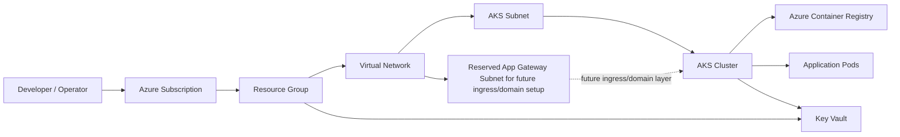

# Azure AKS Infrastructure

This project provisions a secure Azure Kubernetes Service (AKS) environment with networking, Azure Container Registry (ACR), and Key Vault using Terraform.

It is designed for a private, VNet-integrated setup where the AKS cluster and supporting Azure services are deployed in a secure network boundary. The DNS and database modules are currently not active in this root configuration, so the current environment focuses on AKS, ACR, networking, and Key Vault rather than PostgreSQL deployment.

## Architecture overview

The platform includes:

- Azure Resource Group
- Virtual Network with dedicated subnets for AKS and future ingress/domain use
- AKS cluster with managed identity and kubelet identity
- Azure Container Registry for application image storage
- Azure Key Vault for secrets and configuration
- A reserved application gateway subnet kept ready for future domain and ingress integration (not currently provisioned as an app gateway resource)



## Current Terraform configuration

This repository is configured to deploy the following environment based on the values in `terraform.tfvars`:

```hcl
subscription_id = "XXXX"
resource_group_name = "observability-rg"
location = "westus"
environment = "dev"

vnet_name = "observability-vnet"
vnet_address_space = "10.0.0.0/16"
aks_subnet_prefix = "10.0.1.0/24"
database_subnet_prefix = "10.0.2.0/24"
appgw_subnet_prefix = "10.0.4.0/24"

aks_cluster_name = "observability-aks"
aks_dns_prefix = "observability-aks"
aks_node_count = 2
aks_vm_size = "Standard_D2s_v7"

acr_name = "observabilityacrwestusnodjs"
key_vault_name = "keyvaultobservabilitydev"
```

## Project structure

```text
.
├── main.tf
├── providers.tf
├── variables.tf
├── terraform.tfvars
├── README.md
├── usefull-commands.sh
├── modules/
│   ├── aks/
│   ├── acr/
│   ├── keyvault/
│   ├── networking/
│   └── compute/
├── .gitignore
└── .terraform/   # generated locally by Terraform, ignored by git
```

## Prerequisites

Before you start, ensure you have:

- Azure CLI installed and authenticated
- Terraform installed locally
- Access to an Azure subscription with permission to create resource groups, networking, AKS, ACR, and Key Vault resources
- A supported Azure region for the selected VM SKU and services

### Sign in to Azure

```bash
az login
az account set --subscription "<subscription-id-or-name>"
```

You can confirm the active subscription with:

```bash
az account show -o table
```

## Getting started

### 1. Clone the repository and enter the folder

```bash
git clone <your-repository-url>
cd azure-aks-infra
```

### 2. Sign in to Azure from your local machine

```bash
az login
az account set --subscription "<subscription-id-or-name>"
```

This is required before running Terraform from your local machine so Azure CLI can authenticate and authorize resource creation.

### 3. Review the configuration values

Open `terraform.tfvars` and update the values to match your Azure subscription, naming convention, and region.

If you are using a different environment or custom app name, update:

- `resource_group_name`
- `location`
- `aks_cluster_name`
- `acr_name`
- `key_vault_name`

### 4. Initialize Terraform

```bash
terraform init
```

### 5. Validate the configuration

```bash
terraform validate
```

### 6. Review the planned deployment

```bash
terraform plan
```

This step shows every Azure resource that will be created before you apply changes.

### 7. Provision the infrastructure

```bash
terraform apply --auto-approve
```

This will create the following resources:

- Resource group
- Virtual network and subnets
- Reserved application gateway subnet for future ingress/domain integration
- AKS cluster
- ACR registry
- Key Vault
- Role assignments and managed identities

### 8. Get cluster access

After deployment completes, fetch the cluster credentials:

```bash
az aks get-credentials \
  --resource-group <resource-group-name> \
  --name <aks-cluster-name> \
  --overwrite-existing
```

Then test access:

```bash
kubectl get nodes
kubectl get pods -A
```

### 9. Deploy application workloads

Once the cluster is up, you can push a container image to ACR and deploy workloads using Kubernetes manifests or Helm.

Example image push pattern:

```bash
az acr login --name <acr-name>
```

Then build and push your application image to ACR and deploy it to AKS.

## Terraform workflow summary

```bash
terraform init
terraform validate
terraform plan
terraform apply --auto-approve
```

To remove all created resources:

```bash
terraform destroy --auto-approve
```

## Azure resource details

### AKS module

The AKS cluster is provisioned with:

- managed identity for cluster operations
- kubelet identity for pulling ACR images
- network configuration using the AKS subnet
- a node pool sized to `Standard_D2s_v7` in the current configuration

### Networking and future ingress layer

The network is prepared with a dedicated subnet for future ingress/domain integration:

- `appgw_subnet_prefix` is reserved for later use with NGINX Ingress or Azure Application Gateway
- the subnet is intentionally not tied to a live gateway resource in the current Terraform root configuration
- this keeps the network ready for future public-facing traffic management without adding unused components today

### Key Vault and ACR

The project sets up:

- Azure Container Registry for image storage
- Key Vault for secure secret and identity-related configuration
- AKS identity access for pulling images and using assigned permissions
- a future-ready application gateway subnet for domain and ingress integration

## Important operational notes

- Use a region that supports the selected VM SKU and service availability for your Azure subscription.
- Some Azure subscriptions may not allow all regions or all VM sizes, so confirm availability before applying.
- Licensing, quota restrictions, and subscription limits can affect whether the deployment succeeds.
- The app gateway subnet is reserved for future ingress/domain integration and is not currently attached to a live gateway deployment.
- DNS and database modules are intentionally not active in the current root configuration.

## Useful commands

Authenticate and select the right subscription:

```bash
az login
az account set --subscription "<subscription-id>"
```

Check Azure regions and availability:

```bash
az account list-locations -o table
az vm list-skus --location westus --resource-type virtualMachines -o table
```

Check cluster health:

```bash
kubectl get nodes
kubectl get pods -A
kubectl get svc -A
```

## Notes

- This project is designed for a secure Azure environment with private networking and future-ready ingress planning.
- The values in `terraform.tfvars` are the current deployment defaults for this repository.
- The application gateway subnet is intentionally kept as a future-ready network space for domain and ingress integration; it is not currently used by an Application Gateway resource.
- The DNS and database modules are currently commented out in the root configuration, so the active deployment does not create PostgreSQL or a private DNS zone at this time.
- For production use, consider externalizing credentials and secrets via secure secret management and CI/CD pipelines.

## License

This project is intended for infrastructure learning, experimentation, and Azure deployment practice.
